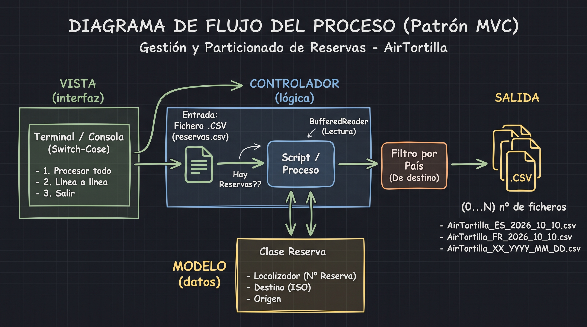
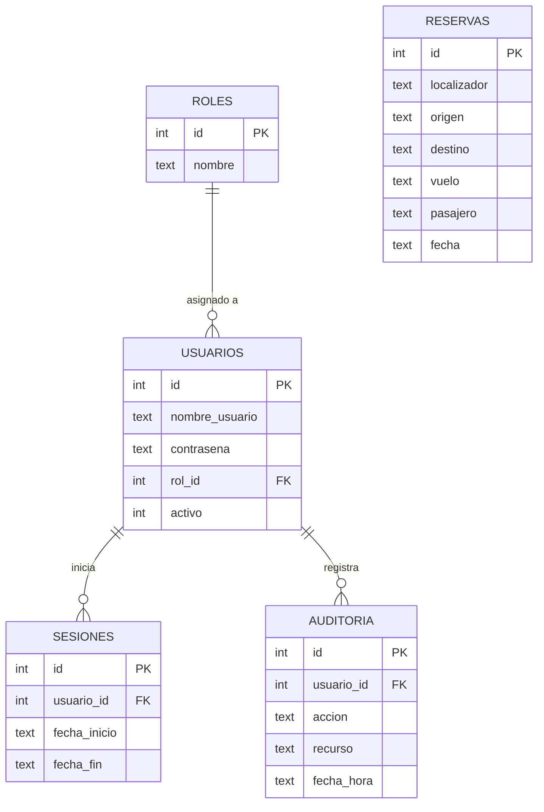

# AirTortilla - Sistema de Gestión y Filtro de Reservas

## Descripción del Proyecto
Módulo de procesamiento de ficheros desarrollado en Java para la aerolínea **AirTortilla**. El sistema procesa un conjunto inicial de reservas en formato CSV, aplica un filtro por país de destino y genera múltiples ficheros particionados respetando el estándar `AirTortilla_XX_YYYY_MM_DD`.

---

## Arquitectura del Sistema (Modelo - Vista - Controlador)

El proyecto sigue el patrón de diseño **MVC**:

- **Modelo (`Model`)**:
  * `Persona`: Representa los datos del pasajero (Documento, Nombre, Edad).
  * `Reserva`: Modela la entidad de la reserva con identificador unívoco / localizador, origen, país de destino (ISO-2), número de vuelo y fecha de realización.
- **Vista (`View`)**:
  * Menú interactivo por **Terminal / Consola** implementado con estructuras `switch-case`, permitiendo interactuar con el sistema tanto en modalidad total como en modalidad línea a línea.
- **Controlador (`Controller`)**:
  * Lógica de lectura de flujos de datos (`BufferedReader`), validación, resolución de colisiones con localizadores y exportación a los ficheros correspondientes por país de destino.

---

## Diagrama de Flujo del Proceso

## Estructura del Fichero CSV de Entrada
El sistema procesa archivos `.csv` con la siguiente estructura de columnas:

| Campo | Cabecera | Tipo | Descripción | Ejemplo |
|---|---|---|---|---|
| 1 | `Destino` | Texto (ISO-2 o País) | País de destino de la reserva | `FR` / `France` |
| 2 | `Origen` | Texto | País o ciudad de origen | `Spain` / `Madrid` |
| 3 | `No. Vuelo` | Texto / Numérico | Identificador del vuelo | `IB3401` |
| 4 | `Nombre` | Texto | Nombre y apellidos del pasajero | `Carlos Ruiz` |

> **Nota:** Los ficheros de datos (`*.csv`) se encuentran excluidos del repositorio mediante `.gitignore` conforme a las especificaciones de entrega.

---

## Cambios — Entrega 2

### Refactorización del código (Paso 0)
Se simplificó `ArchivoReservas.java` para hacer el código más sencillo y legible, sin cambiar funcionalidades:
- Se eliminaron todos los `String.format(...)` sustituyéndolos por concatenación con `+`.
- Se reemplazaron `merge()` y `computeIfAbsent()` por operaciones explícitas con `if / getOrDefault / put`.
- La iteración sobre mapas pasó de `Map.Entry` a `for (clave : mapa.keySet())`.
- Se extrajo el método auxiliar `lineaCSV(...)` para construir líneas CSV sin repetir lógica.

---

### Paso 1: Diseño de Datos y Modelo Relacional
Conforme a los requerimientos de la Entrega 2, se diseñó el esquema relacional para dar soporte a la gestión de accesos, roles, auditoría y reservas:

#### Diagrama Entidad-Relación (ER)

#### Scripts de Inicialización
- **`schema.sql`**: Script DDL que define las 5 tablas del modelo relacional (`roles`, `usuarios`, `sesiones`, `auditoria`, `reservas`) asegurando claves primarias, claves foráneas e integridad referencial.
- **`data.sql`**: Script DML inicial (seeds) que precarga los roles básicos (`ADMINISTRADOR`, `EMPLEADO`) y el usuario administrador por defecto (`admin`), cuya contraseña se almacena de forma segura mediante hash SHA-256 (`admin123`).

---

### Paso 2: Conexión, Seguridad y Migración de Datos a la BD
Se crearon las clases necesarias con Java estándar y JDBC directo para dar soporte a la persistencia e inicio de sesión seguro:

- **`ConexionBD.java`**: Gestiona la conexión JDBC a la base de datos SQLite (`airtortilla.db`) y ejecuta automáticamente `schema.sql` y `data.sql` al inicializar el sistema.
- **`SeguridadUtil.java`**: Utilidad nativa de hashing mediante algoritmo **SHA-256** para el almacenamiento y verificación segura de credenciales de usuario.
- **`MigracionDatos.java`**: Lee los ficheros históricos `AirTortilla_*.csv` generados en la Entrega 1 e inserta todas las reservas en la tabla `reservas` mediante `PreparedStatement` evitando duplicados.
- **`UsuarioDAO.java`**: Capa de acceso a datos para autenticación de credenciales, registro de sesiones de usuario (`sesiones`) y creación de nuevos usuarios por parte del Administrador.
