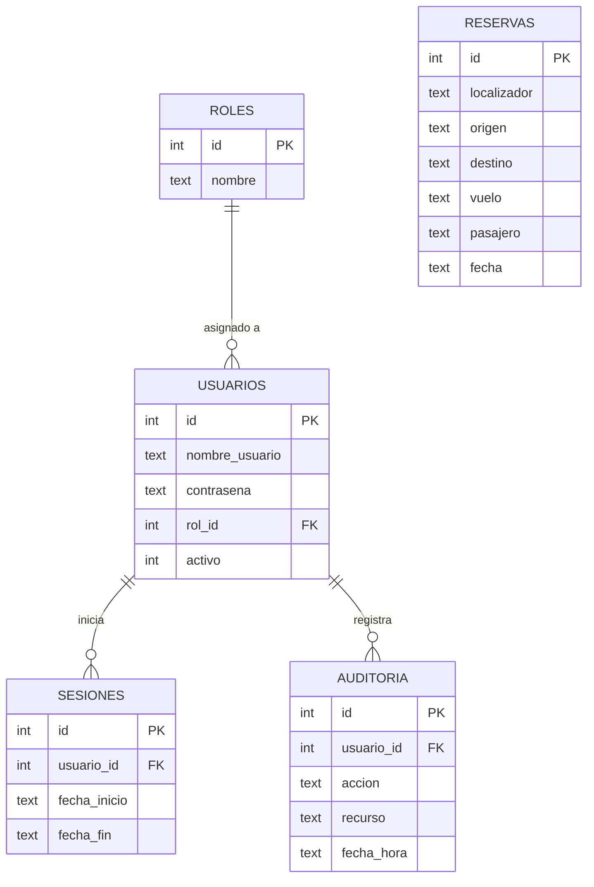

# AirTortilla - Sistema de Gestión y Filtro de Reservas

## Descripción del Proyecto
Módulo de procesamiento de ficheros desarrollado en Java para la aerolínea **AirTortilla**. El sistema procesa un conjunto inicial de reservas en formato CSV, aplica un filtro por país de destino y genera múltiples ficheros particionados respetando el estándar `AirTortilla_XX_YYYY_MM_DD`.

---

## Arquitectura del Sistema (Modelo - Vista - Controlador)

El proyecto sigue el patrón de diseño **MVC**:

- **Modelo (`Model`)**:
  * `Persona`: Representa los datos del pasajero (Documento, Nombre, Edad).
  * `Reserva`: Modela la entidad de la reserva con identificador unívoco / localizador, origen, país de destino (ISO-2), número de vuelo y fecha de realización.
- **Vista (`View`)**:
  * Menú interactivo por **Terminal / Consola** implementado con estructuras `switch-case`, permitiendo interactuar con el sistema tanto en modalidad total como en modalidad línea a línea.
- **Controlador (`Controller`)**:
  * Lógica de lectura de flujos de datos (`BufferedReader`), validación, resolución de colisiones con localizadores y exportación a los ficheros correspondientes por país de destino.

---

## Diagrama de Flujo del Proceso


## Estructura del Fichero CSV de Entrada
El sistema procesa archivos `.csv` con la siguiente estructura de columnas:

| Campo | Cabecera | Tipo | Descripción | Ejemplo |
|---|---|---|---|---|
| 1 | `Destino` | Texto (ISO-2 o País) | País de destino de la reserva | `FR` / `France` |
| 2 | `Origen` | Texto | País o ciudad de origen | `Spain` / `Madrid` |
| 3 | `No. Vuelo` | Texto / Numérico | Identificador del vuelo | `IB3401` |
| 4 | `Nombre` | Texto | Nombre y apellidos del pasajero | `Carlos Ruiz` |

> **Nota:** Los ficheros de datos (`*.csv`) se encuentran excluidos del repositorio mediante `.gitignore` conforme a las especificaciones de entrega.

---

## Cambios — Entrega 2

### Refactorización del código (Paso 0)
Se simplificó `ArchivoReservas.java` para hacer el código más sencillo y legible, sin cambiar funcionalidades:
- Se eliminaron todos los `String.format(...)` sustituyéndolos por concatenación con `+`.
- Se reemplazaron `merge()` y `computeIfAbsent()` por operaciones explícitas con `if / getOrDefault / put`.
- La iteración sobre mapas pasó de `Map.Entry` a `for (clave : mapa.keySet())`.
- Se extrajo el método auxiliar `lineaCSV(...)` para construir líneas CSV sin repetir lógica.

---

### Paso 1: Diseño de Datos y Modelo Relacional
Conforme a los requerimientos de la Entrega 2, se diseñó el esquema relacional para dar soporte a la gestión de accesos, roles, auditoría y reservas:

#### Diagrama Entidad-Relación (ER)


#### Scripts de Inicialización
- **`schema.sql`**: Script DDL que define las 5 tablas del modelo relacional (`roles`, `usuarios`, `sesiones`, `auditoria`, `reservas`) asegurando claves primarias, claves foráneas e integridad referencial.
- **`data.sql`**: Script DML inicial (seeds) que precarga los roles básicos (`ADMINISTRADOR`, `EMPLEADO`) y el usuario administrador por defecto (`admin`), cuya contraseña se almacena de forma segura mediante hash SHA-256 (`admin123`).

---

### Paso 2: Conexión, Seguridad y Migración de Datos a la BD
Se crearon las clases necesarias con Java estándar y JDBC directo para dar soporte a la persistencia e inicio de sesión seguro:

- **`ConexionBD.java`**: Gestiona la conexión JDBC a la base de datos SQLite (`airtortilla.db`) y ejecuta automáticamente `schema.sql` y `data.sql` al inicializar el sistema.
- **`SeguridadUtil.java`**: Utilidad nativa de hashing mediante algoritmo **SHA-256** para el almacenamiento y verificación segura de credenciales de usuario.
- **`MigracionDatos.java`**: Lee los ficheros históricos `AirTortilla_*.csv` generados en la Entrega 1 e inserta todas las reservas en la tabla `reservas` mediante `PreparedStatement` evitando duplicados.
- **`UsuarioDAO.java`**: Capa de acceso a datos para autenticación de credenciales, registro de sesiones de usuario (`sesiones`) y creación de nuevos usuarios por parte del Administrador.

---

### Paso 3: Módulo de Trazabilidad y Auditoría
Para cumplir con el requerimiento de control de cambios y auditoría de la aerolínea:

- **`AuditoriaDAO.java`**: Registra de forma automática cada evento significativo en la base de datos relacional (`usuario_id`, `accion`, `recurso`, `fecha_hora`), tales como inicios de sesión (`LOGIN`), generación de ficheros y altas de nuevos usuarios. Permite al Administrador consultar el histórico completo ordenado cronológicamente.

---

### Paso 4: Interfaz Web Nativa (Sin Frameworks Externos)
Se migró la interacción con el usuario de consola/terminal a un entorno web accesible mediante navegador:

- **`ServidorWeb.java`**: Implementa un servidor HTTP nativo de Java (`com.sun.net.httpserver.HttpServer`) en el puerto `8080` con interfaz moderna diseñada con Bootstrap 5:
  - **Login (`/login`)**: Control de acceso para empleados y administradores con validación segura.
  - **Dashboard (`/dashboard`)**: Panel principal con estadísticas de reservas en base de datos y botones de acción para generar los ficheros particionados (modalidad total y línea a línea).
  - **Gestión de Usuarios (`/admin`)**: Panel exclusivo para administradores que permite dar de alta nuevos usuarios especificando su rol (`EMPLEADO` o `ADMINISTRADOR`).
  - **Panel de Auditoría (`/auditoria`)**: Vista de trazabilidad con tabla detallada de todas las acciones del sistema.
  - **Cierre de Sesión (`/logout`)**: Registro de fin de sesión y retorno a la pantalla de acceso.

- **`Main.java`**: Orquesta el arranque completo de la aplicación (inicialización de tablas, migración de datos y puesta en marcha del servidor web).

---

### Paso 5: Contenerización con Docker y Docker Compose (Opcional / Deseable)
Para garantizar la portabilidad y facilitar el empaquetado del sistema conforme al apartado 3.2 de la entrega:

- **`Dockerfile`**: Construye una imagen ligera basada en Eclipse Temurin (Java 21), descarga el driver JDBC de SQLite, compila el código fuente y expone el puerto `8080`.
- **`docker-compose.yml`**: Orquesta el despliegue del contenedor `airtortilla-app` montando un volumen persistente para la base de datos `airtortilla.db`.

```bash
# Levantar la aplicación con Docker Compose
docker compose up --build
```

---

## Matriz de Trazabilidad: Historias de Usuario a Tareas Medibles

Conforme al objetivo general de la entrega, se desglosaron los requerimientos encomendados en tareas técnicas concretas y medibles:

| Historia de Usuario (Rol) | Tareas Técnicas Medibles | Implementación en Código | Estado |
|:---|:---|:---|:---:|
| **Empleado:** Poder hacer log in | • Esquema de tablas `usuarios` y `sesiones`<br>• Hashing seguro de credenciales (SHA-256)<br>• Pantalla web de login y autenticación | `schema.sql`<br>`SeguridadUtil.java`<br>`UsuarioDAO.java`<br>`ServidorWeb.java` | ✅ Completado |
| **Administrador:** Dar de alta nuevos usuarios | • Formulario web exclusivo para administrador<br>• Asignación de rol (`EMPLEADO` / `ADMINISTRADOR`)<br>• Inserción en base de datos con contraseña hasheada | `UsuarioDAO.java`<br>`ServidorWeb.java` | ✅ Completado |
| **Administrador:** Mantener la trazabilidad (auditoría / logs) | • Captura de eventos relevantes (`LOGIN`, `GENERAR_FICHEROS`, `CREAR_USUARIO`)<br>• Persistencia en tabla `auditoria`<br>• Vista web del histórico de auditoría | `schema.sql`<br>`AuditoriaDAO.java`<br>`ServidorWeb.java` | ✅ Completado |
| **Normativa Legal:** Migración a Base de Datos Relacional | • Diseño de diagrama ER con integridad referencial<br>• Scripts de creación (`schema.sql`) y datos iniciales (`data.sql`)<br>• Migración automática de datos desde archivos CSV a SQLite | `schema.sql`<br>`data.sql`<br>`ConexionBD.java`<br>`MigracionDatos.java` | ✅ Completado |
| **DevOps:** Contenerización (Opcional / Deseable) | • Empaquetado de la aplicación en contenedor Docker<br>• Orquestación con volumen persistente | `Dockerfile`<br>`docker-compose.yml` | ✅ Completado |

---

## Credenciales de Acceso por Defecto
Al iniciar por primera vez, el sistema precarga el usuario administrador:
- **Usuario:** `admin`
- **Contraseña:** `admin123` (almacenada como hash SHA-256 en la base de datos)
- **URL de acceso:** `http://localhost:8080/login`
